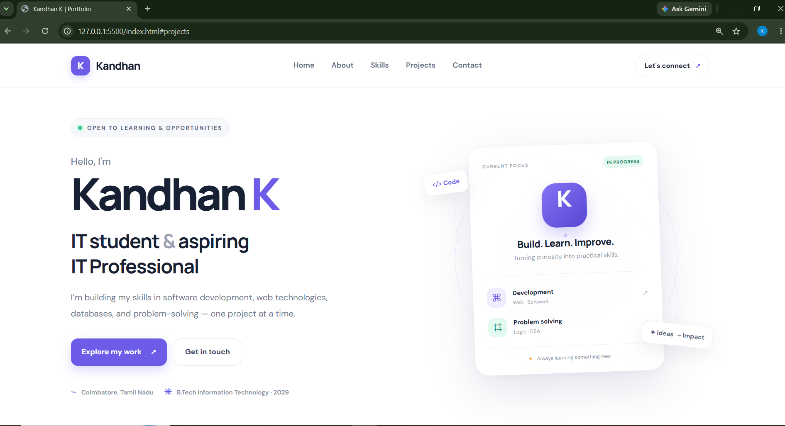
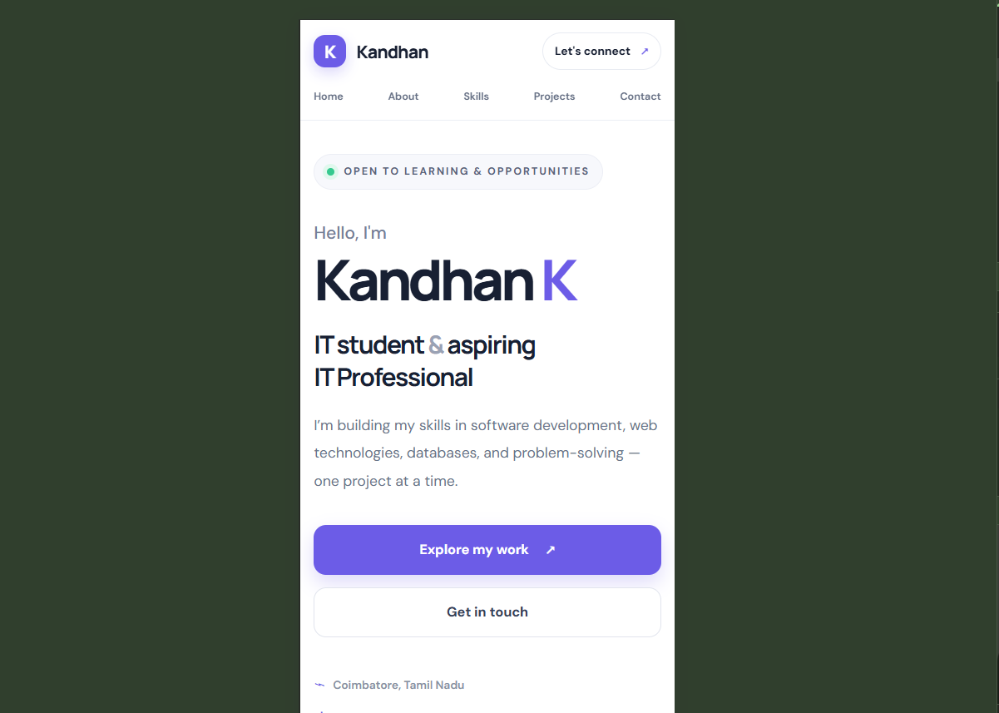

# Personal Portfolio Website

## About the Project

This is my personal portfolio website, developed as part of my HTML and CSS internship project. It showcases my educational background, technical skills, projects, and contact information.

The website is designed with a clean, modern layout to present my profile as an Information Technology student and aspiring software developer.

## About Me

**Name:** Kandhan K.  
**Role:** IT Student | Aspiring Software Developer  
**College:** Sri Krishna College of Engineering and Technology (SKCET), Coimbatore  
**Degree:** B.Tech Information Technology  
**Expected Graduation:** 2029  
**Location:** Coimbatore, Tamil Nadu, India

## Technologies Used

- HTML5
- CSS3
- Google Fonts

## Features

- Home section introducing me and my career interests
- About Me section highlighting my educational background
- Skills section showcasing my technical skills
- Projects section presenting my project work
- Contact section with links to my professional profiles
- Responsive layout for desktop and mobile devices
- Modern styling with hover effects and organized layouts

## Projects Included

### 1. Privacy Browser 2.0

A privacy-focused browser project aimed at improving website privacy and helping protect sensitive personal information.

**Status:** In Progress

### 2. Database Design Practice

A learning project focused on database design and organizing information using database concepts.

**Status:** Learning Project

## Technical Skills

- HTML5
- CSS3
- JavaScript
- Python
- C and C++
- SQL and MySQL
- Java
- GitHub

## How to Run the Project

1. Download or clone this repository.
2. Open the project folder.
3. Double-click `index.html` to open the website in your browser.

No additional installation is required.

## Connect With Me

- **GitHub:** [kandhan-k15](https://github.com/kandhan-k15)
- **LinkedIn:** [Kandhan K.](https://www.linkedin.com/in/kandhan-k-b2b024380/)
- **Email:** [kandhank1506@gmail.com](mailto:kandhank1506@gmail.com)

## Screenshots

### Desktop View

### Mobile View

## Acknowledgement

This project was developed as part of my HTML and CSS internship to improve my web development skills and build a professional online portfolio.

---

**Developed by Kandhan K.**  
*Built with HTML5 and CSS3.*